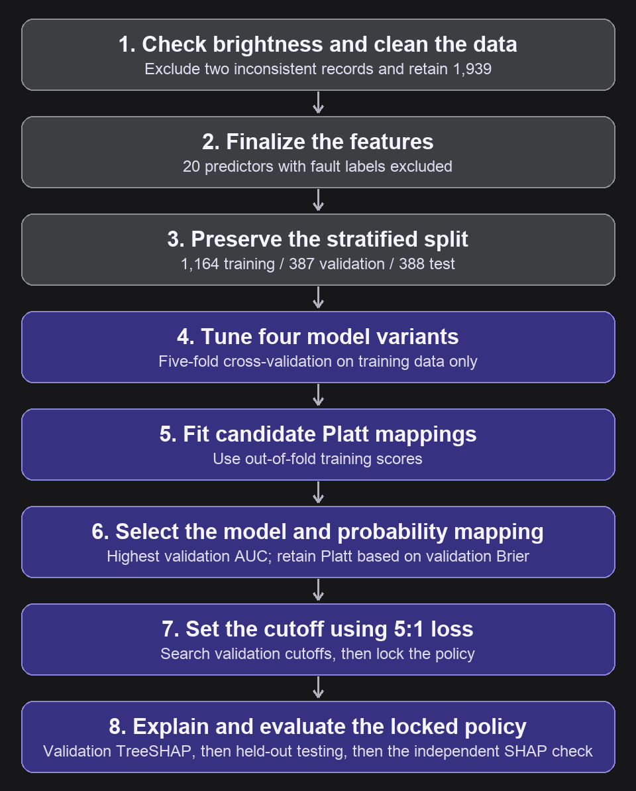

# DBA5106 Project 2 · Steel scratch triage

## The decision

A steel surface inspection system has already flagged a defect. The model estimates whether the fault is a scratch so a quality inspector can route it to a priority review queue. Other flagged faults continue through standard review. The classification unit is one fault record. The positive label combines `Z_Scratch` and `K_Scatch` (the spelling in the supplied CSV).

The evaluation loss is `(5 × missed scratches + false alarms) / number of records`. A missed scratch review uses five units and an unnecessary priority review uses one. The 5:1 ratio is an illustrative assumption. The validation analysis also checks 2:1 and 10:1.

Source: [Faulty Steel Plates, UCI Machine Learning on Kaggle](https://www.kaggle.com/datasets/uciml/faulty-steel-plates), usability 8.24/10. The supplied wafer project informed the presentation structure. This project uses `data/faults.csv` and its own features, models and results.

## Open or rerun

Open [Project2_Steel_Scratch_Triage_TreeSHAP_Audit.ipynb](Project2_Steel_Scratch_Triage_TreeSHAP_Audit.ipynb) for the completed analysis, figures, and independent TreeSHAP check. Run the notebook from this folder so it can import `analysis.py`. To run all notebook cells, install `shap==0.51.0` and `ipykernel` alongside the pinned requirements.

```bash
python -m pip install -r requirements.txt
python analysis.py
```

Python 3.12 was used for the delivered run. Jupyter or VS Code's Jupyter extension can run the notebook using the same environment. The Python command regenerates `results/` from the included data. The small tuning grids take roughly one to two minutes on a CPU.

## Workflow



## What was fitted

- **Data.** 1,939 retained defects, including 579 scratches (29.9%). The analysis excludes two K_Scatch records, source rows 518 and 591 (zero-based), because derived mean brightness is below the recorded minimum. Source IDs and exclusion details are recorded in the results summary. Zero missing cells, exact duplicate rows or duplicate predictor vectors after feature extraction. Use 20 geometry, image brightness and plate-property features. Exclude labels, absolute image coordinates, conveyor length and redundant representations. Derive width, height and mean brightness.
- **Partitions.** Use 1,164 training, 387 validation and 388 test records. Retained rows keep their original stratified split assignments. Tune each of the four candidates independently by five-fold CV AUC on training. Select the model on separate validation AUC. The input gives no line, lot or date identifiers for a grouped or chronological split.
- **Glass box.** LASSO on the 0/1 label and L1 logistic regression. The coefficient penalty is L1 in both. Their training losses are squared error (L2) and binomial log loss.
- **Black box.** Gradient-boosted trees with squared error or binomial log loss, using the same grid for both. The selected configuration has depth 3, 240 trees, 15 minimum records per leaf and learning rate 0.05.
- **Calibration and decision.** Fit a Platt mapping to out-of-fold training scores. Compare raw and calibrated Brier scores on validation and retain Platt for its slightly lower Brier score and positive slope. The validation ECE increases slightly. Search all distinct validation decisions to minimize the 5:1 loss. Lock the threshold before evaluating the test set.
- **TreeSHAP.** Compute exact tree-path-dependent attributions by enumerating each shallow tree's feature coalitions and summing the resulting attributions. Global importance uses mean absolute attribution across validation. The local example is a missed `Z_Scratch` from validation. The contributions reconstruct the tree ensemble's raw margins. The independent notebook check compared the base value and all 7,740 feature contributions with the SHAP library on the 387 validation records. The largest attribution difference was 6.2 × 10⁻¹⁵.

## Result

| Candidate | Validation AUC |
|---|---:|
| LASSO, L2 | 0.8714 |
| L1 logistic, log loss | 0.9152 |
| Boosted trees, L2 | 0.9663 |
| **Boosted trees, log loss** | **0.9701** |

The selected validation cutoff is **0.1626452671** (shown as 0.1626 in the slides). Validation weighted loss per record falls from 0.2558 at 0.50 to 0.1809. Brier score moves from 0.0574 to 0.0566 with Platt scaling. ECE moves from 0.0259 to 0.0281.

On the 388 retained held-out records, **test AUC is 0.9835** (95% bootstrap interval 0.9708–0.9929). This is a reanalysis of the original holdout after excluding the invalid brightness record.

| Held-out operating point | Missed scratches | False alarms | Priority reviews | Weighted loss per record |
|---|---:|---:|---:|---:|
| Default cutoff 0.50 | 12 | 12 | 115 | 0.1856 |
| Tuned cutoff 0.1626 | 3 | 32 | 144 | 0.1211 |
| Review all | 0 | 273 | 388 | 0.7036 |

The tuned rule catches 112 of 115 scratches (97.4% recall) and returns 77.8% priority-review precision. The observed loss is 34.7% lower than at 0.50. The paired 95% bootstrap interval for savings is −0.0103 to 0.1443 loss units per record, so the observed advantage remains uncertain on this sample.

Outside X index, plate thickness and Edges index lead the global attributions. Keeping the selected tree configuration and removing thickness and grade reduces validation AUC to 0.9175. This sensitivity matters for transfer to a line with a different mix of plate properties. The source provides limited definitions for several indices. Deployment would need prospective lot- or date-separated validation and a measured review cost.

## Files

- `Project2_Steel_Scratch_Triage_TreeSHAP_Audit.ipynb` – executed walkthrough with model comparison, calibration, threshold selection, held-out results, and the independent TreeSHAP check
- `analysis.py` – implementation and command-line entry point
- `data/faults.csv` – unchanged copy of the uploaded source file
- `results/summary.json` – evaluation metrics, split counts, and model details in machine-readable form
- `results/*.csv` – CV search scores, threshold sweep, cost sensitivity, predictions and SHAP attributions
- `results/figures/` – curves and SHAP figures used in the presentation
